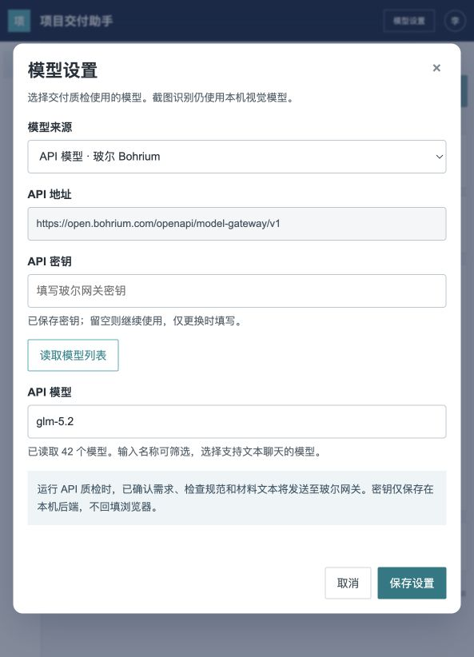
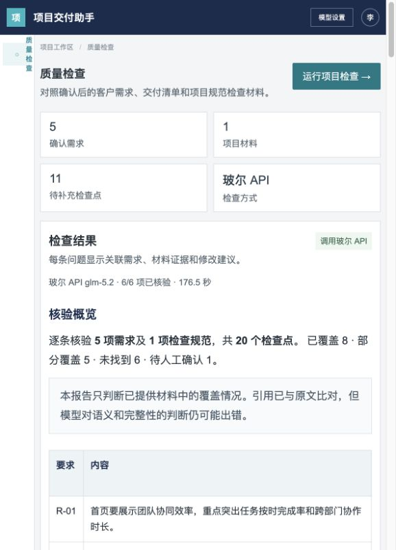

# 项目交付助手 Demo v0.2

一个本地运行的项目交付与汇报助手原型。核心流程：创建项目 → 导入历史聊天、截图识别或模拟机器人接入 → 确认需求并整理交付清单 → 上传交付材料 → 本地模型质检 → 模拟汇报问答。

## 启动

1. 安装 Node.js，推荐 24；运行测试也支持对应主版本中的 20.19+ 或 22.13+。
2. 首次运行在本目录执行 `npm install` 安装本地 Office/PDF 解析依赖。
3. 双击 `启动Demo.bat`，或在本目录运行 `node server.js`。
4. 浏览器打开 `http://127.0.0.1:4174`。
5. 在“项目列表”中打开项目，点“载入演示项目”体验完整主流程。

## 本地模型

Demo 通过 Ollama 本机 API 调用模型。安装 Ollama 并下载模型后，在页面右上角“模型设置”配置名称，例如 `qwen3:4b`。Ollama 服务可用时点击“重新检测”，页面应显示模型已连接。

```powershell
ollama pull qwen3:4b
```

选择本地模式时，检查请求发往 `127.0.0.1:11434`，项目材料不发送到云端模型服务。模型下载首次需要联网。

## 玻尔 API 模型

右上角“模型设置”选择“API 模型 · 玻尔 Bohrium”，输入玻尔网关密钥，点击“读取模型列表”，输入名称搜索并选择支持文本聊天的模型，最后保存。也可填写控制台中的完整模型 ID，模型列表不在代码中写死。

网关地址固定为 `https://open.bohrium.com/openapi/model-gateway/v1`。API 质检会将已确认需求、规范和材料文本发送至该网关，页面会显示实际模型来源；截图识别仍使用本机视觉模型。

密钥由本机后端保存在 `.env.local`（仅当前用户可读写），不放入前端存储、不回填设置页面、不随 Git 提交，也不通过静态文件服务公开。也可参照 `.env.example` 使用 `BOHRIUM_API_KEY`、`BOHRIUM_MODEL`、`MODEL_PROVIDER` 环境变量。未配置密钥前不能进行真实 API 核验。

调用使用兼容的 `/models` 和 `/chat/completions` 接口。模型若明确拒绝 JSON 输出参数，会尝试不带该参数的调用，返回结果仍需经过 JSON 和证据校验。模型权限、可用性及具体能力以网关实际返回为准；API 失败不会静默切回本地模型。

关闭或刷新正在质检的页面时，后端会中断当前请求并停止后续 API 调用。



## 功能说明

- 项目列表：新建项目，填写名称、客户、负责人和项目周期。
- 项目概览：导入历史聊天、手动上传截图，或选择微信桌面窗口开启本地监测；也可配置模拟机器人接入。页面步骤条和每页底部“下一步”按钮均可导航。
- 微信截图需求来源：选择“自动监测微信窗口”，刷新并选择微信窗口，填写目标群聊名称，选择本机视觉模型并点击“开始监测”。Demo 定时截取该窗口，将截图交给本机 Ollama 判断群名并提取新消息；只保留群名匹配且内容有变化的截图。需安装支持图片输入的本地视觉模型（如 `qwen3-vl:4b`）；普通文本模型不能识图。监测持续到手动停止或关闭 Demo 服务，关闭浏览器页面本身不会停止。
- 需求与交付清单：从聊天提取需求候选，确认后生成交付项，可编辑与添加清单项。
- 交付材料：上传文档、图片、视频等文件并关联清单项。TXT、MD、CSV、DOCX、可搜索 PDF、XLSX 可提取文本参加模型检查；图片、视频目前只列入材料列表。
- 质量检查：先确认需求，再由本机 Ollama 分别拆解并核验每条要求；并列文件、指标等拆成检查点。报告区分已覆盖、部分覆盖、未找到和待人工确认，证据附文件名及行号，并与原文校验。实际履约时间等保留人工确认。未解析附件、模型失败、材料超出单轮范围会明确提示，不自动冒充 AI 检查成功。选择 `rules` 模型时可显式运行关键词规则演示。
- 报告阅读：本地加载 Marked 和 DOMPurify，渲染 Markdown 标题、列表、表格、引用及代码块；过滤不安全 HTML 和图片，宽表格可独立横向滚动。
- 汇报演练：可体验文字问答与反馈。语音输入目前是交互示意，尚未接入语音识别。

## 边界

质检仍是辅助意见。逐条覆盖和引用校验可减少整条漏项及伪造引用，但不能保证模型拆解完整、语义判断准确或材料中的数据真实。项目检查规范也会作为独立要求核验。当前使用保守的输入预算，超出本机单轮上下文范围时提示拆分，尚未实现长文检索。

聊天机器人连接是模拟状态，不会实际加入办公软件群聊。微信监测通过 Windows 桌面窗口截图实现，不读取微信数据库；须由用户在页面明确启动并可随时停止。微信窗口需保持打开且可见，部分 GPU 渲染版本可能截图为空白；识别结果可能出错，需求仍需人工确认。已确认且有新消息的截图保存在 Demo 目录 `captures`。扫描版 PDF 暂无 OCR；材料区的图片和视频暂不做内容识别。聊天接入、项目隔离、用户权限、索引加密和审计策略需要在真实企业部署时完善。

## 验证

运行 `npm test` 检查证据定位、缺失结果兜底、履约时间、模型失败、输入上限，以及 Markdown 渲染与 HTML 清洗。`tests/fixtures/demo-review.json` 保留原演示需求与材料，便于复跑本地模型；一次演示复测不代表通用准确率。

以下为同一份演示材料使用玻尔网关 `glm-5.2` 的真实核验界面；材料中的项目、人员和业务指标均为演示数据。


